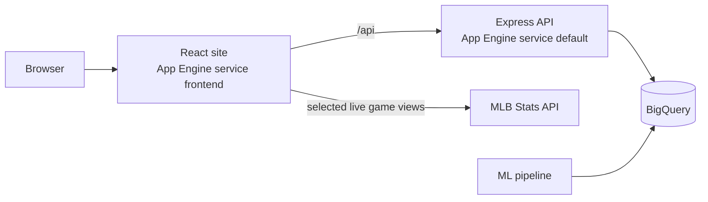

# Hank's Tank

> **Live:** https://hankstank.com
> **Part of the same system:** API in [hanks_tank_backend](https://github.com/elijahcraig45/hanks_tank_backend) · ML pipeline in [hanks_tank_ml](https://github.com/elijahcraig45/hanks_tank_ml)

The React site for Hank's Tank: predictions, model scoreboards, power rankings, season projections
and stats for MLB, NFL and college football (FBS and FCS), plus a pick'em contest. Every number on
the site comes from the [ML pipeline](https://github.com/elijahcraig45/hanks_tank_ml) through the
[API](https://github.com/elijahcraig45/hanks_tank_backend); a few live MLB game views also read the
MLB Stats API directly.

## What's on the site

| Section | What it shows |
|---|---|
| Predictions | Each game's pick with its win probability and confidence tier, per-game pages, and player projections |
| Models | Every model's pregame call side by side, with a scoreboard that only counts predictions made before the game started |
| Diagnostics | A model audit: calibration, accuracy by confidence tier and by slice |
| Power rankings | Ratings with plausible rank ranges, a plain-language reason for each team's spot, a results-based college resume board, and AP / Coaches poll columns |
| Season projections | Playoff, division and title odds from 10,000 simulated seasons (NFL and FBS) |
| Scouting report | Per-game college football report: picks, rankings and key players |
| Scores and games | MLB live linescore, play-by-play and a D3 strike zone; college football scoreboard |
| Stats | MLB team and player batting and pitching, Statcast tools, comparisons, transactions; football leaders, players and team stats |
| Pick'em | A weekly picks contest with a leaderboard |
| Learn | Long-form write-ups on how the models work |

The model control plane can hide or pause a model, put up a site banner, or choose which ranking
columns appear, all without a deploy. When the MLB headline model is paused, the API names a stand-in
and the site says so.

## System context



## Stack

| Layer | Technology |
|---|---|
| Framework | React 18, React Router 6 |
| UI | Bootstrap 5, React Bootstrap |
| Charts | D3 v7, Recharts |
| Data access | Central `ApiService` with timeouts, retries and caching |
| Hosting | App Engine service `frontend` serving the static build, on `hankstank.com` and `www.hankstank.com` |
| CI | GitHub Actions runs the test suite (309 tests) and the build on every push. The deploy job skips itself because no GCP credentials are configured, so deploys are manual (`npm run deploy`) |

## Local development

1. Install dependencies:
   ```bash
   npm install
   ```
2. Create `.env.local` from `.env.example`.
3. Set local values:
   ```env
   REACT_APP_API_URL=http://localhost:8080/api
   REACT_APP_DEFAULT_SEASON=2026
   ```
4. Start the app:
   ```bash
   npm start
   ```

## Useful scripts

| Command | Purpose |
|---|---|
| `npm start` | Start the development server |
| `npm test -- --watchAll=false` | Run the test suite once |
| `npm run build` | Build a production bundle |
| `npm run build:prod` | Build with production env values |
| `npm run deploy` | Build and deploy to App Engine |

## Production routing

- `https://hankstank.com/*` and `https://www.hankstank.com/*` serve the React site.
- `https://hankstank.com/api/*` and `https://www.hankstank.com/api/*` are dispatched to the API service.
- In production the site calls same-origin `/api`, so the custom domain is the main entry point.

## Repository structure

```text
src/
├── App.js              routes for /mlb, /nfl, /cfb, /pickem and /learn
├── components/
│   ├── football/       NFL and college football sections
│   ├── predictions/    prediction cards and game pages
│   ├── models/         model scoreboard and comparisons
│   ├── seasonSim/      season projections
│   ├── pickem/         pick'em contest
│   ├── analytics/      MLB analysis tools
│   └── styles/
├── config/             sports, leagues and section navigation
├── services/           API client
└── utils/
```

## License

MIT
